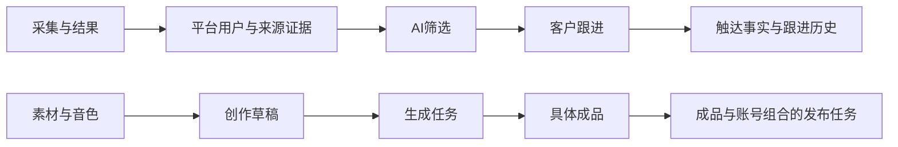

# 整体重构实施与验收

目标：重构完整业务流程、验证功能稳定性、重新设计桌面界面。测试阶段直接使用新数据结构，不实现旧数据库或旧路由兼容。

## 页面与流程

- 工作台：进行中任务、待处理客户、待发布作品、失败处理及配置入口。
- 获客：侧栏统一进入获客工作台，常驻“采集与结果、AI筛选、来源与证据、采集与筛选规则”四个页签；数据维护保留为辅助入口。
- 客户：跟进、触达记录；私信准备与确认发送分开。
- 引流：计划、执行、操作记录；计划可编辑复制。
- 内容：创作、素材/音色、作品库、发布中心；同页选素材、持久草稿、稳定成品引用。
- 自动化：固定三类计划、配置与单次执行分离。
- 任务中心：真实排队与执行状态、业务名称、详情跳转。
- 账号中心与系统设置独立；业务默认参数从各模块进入。

### 页面设计

| 页面 | 用户在这里完成什么 | 主体内容与下一步 |
| --- | --- | --- |
| 工作台 | 决定今天先做什么、继续未完成工作 | 少量待处理摘要、最近任务、开始获客/跟进/创作/引流入口；异常直达对应业务。首次使用给出必要配置入口。 |
| 采集与结果 | 从来源取得候选账号和线索 | 任务名称、来源、进度、产出为主列表；新建在对话框完成；抽屉查看结果、来源证据和失败原因，可继续筛选。 |
| AI筛选 | 判断候选是否值得跟进 | 竞品账号、客户意向两类列表；查询条件与请求一致；详情提供结论和证据，可继续采评论或打开客户。失败与历史作为辅助入口。 |
| 客户跟进 | 为每位客户选择并记录下一步 | 按关键词、意向、跟进状态检索；详情集中呈现资料、来源、话术和跟进历史。复制/打开主页只算准备，实际发送确认才写发送事实。 |
| 触达记录 | 核对一次触达做了什么 | 批次列表、逐客户结果、失败原因、执行账号和时间；从记录回到客户，不重复维护客户资料。 |
| 引流运营 | 配置、运行、复盘互动计划 | 计划、执行、操作记录三种视图；计划可编辑/复制，详情与动作明细独立分页；规则从此模块进入。 |
| 视频创作 | 从素材和文案得到可预览作品 | 文案、素材、配音作为主要步骤；选素材保持同页上下文，高级视频参数折叠；持久草稿显示保存状态，生成后进入作品库。 |
| 素材与音色 | 维护可反复使用的原料 | 上传、分类、搜索、预览、用途；素材选择与浏览筛选分开，换页或搜索不取消已选项。 |
| 作品库 | 找到稿件、生成过程或具体成品 | 草稿、生成任务、成品三个页签。成品可预览、下载、用于发布；同一个任务重试产生新的成品版本。 |
| 发布中心 | 决定将哪份成品发给哪个账号 | 按成品×账号创建任务；各账号可调整标题/正文，提交前展示范围及校验；记录显示成功、失败或结果不明，保留历史关联。 |
| 自动化计划 | 把已经可手动完成的流程定时运行 | 固定获客、私信、引流三类；编辑计划与查看单次运行分开，展示顺序、时间、启停、最近结果；运行详情回到实际业务任务。 |
| 任务中心 | 了解排队、执行阶段和异常 | 业务名称、状态、开始时间、失败原因及业务详情入口；后台决定可否安全重试，不对发送/发布提供无条件重放。 |
| 账号中心 | 准备各模块可用的执行账号 | 账号用途、默认用途、用户/创作者登录及各功能可用状态；从业务进入后保留返回路径和查询条件。 |
| 系统设置 | 管理软件与本地数据 | 授权、更新、备份恢复、数据清理。业务默认值仍放在相应模块设置内。 |

主页面统一使用“标题与主操作 → 筛选 → 列表”，按需打开详情。创建表单、高级配置和完整日志不长期占据主列表宽度。来源树和原始表格保留为辅助检查入口。

获客四个页签共用固定标题和导航，复用已有路由、页面及业务接口。新建采集仍在弹窗完成，保留当前列表筛选；采集列表搜索、分页与任务详情写入地址，页签返回恢复各自查询和工作位置，刷新及浏览器前进后退仍可用。AI详情与来源树仅缓存两个页面实例，保留分析对象、树展开和子节点分页；规则页不缓存，切换前继续允许保留输入或明确放弃修改，不自动提交。AI筛选页的同模块往返按钮由统一页签替代。

### 数据流与存储设计

两条主要流程各自完整：采集 → 来源归一化 → AI判断 → 客户跟进 → 触达事实；素材/文案 → 创作草稿 → 生成任务 → 稳定成品 → 发布任务。引流与自动化复用这些对象和执行机制，不复制另一套客户或素材。

| 数据对象 | 存储与关联原则 |
| --- | --- |
| 平台用户与客户 | 用平台稳定身份识别同一用户，昵称只是资料；客户是用户的业务扩展。一个客户允许多个内容/评论/关键词来源，重复采集不重复创建客户。执行账号单独管理。 |
| 来源与分析 | 保存原始记录引用、来源关系、分析对象、结论、依据和时间。列表是查询结果，筛选分页不创建新数据副本。 |
| 草稿 | SQLite 保存非敏感参数和稳定对象 ID；可不完整，后台限定允许字段；前端串行写入，失败保留输入，恢复重试不能覆盖本地新内容。 |
| 业务任务与运行记录 | 业务任务保存用途、对象与选择快照；运行记录保存排队、尝试、取消、失败和中断。计划修改不覆盖已开始运行的配置。 |
| 生成成品 | 每份成品都有独立 output_id 与文件引用；重试新增成品，已存在的发布任务继续引用当时那份成品。 |
| 对外操作事实 | 发送与发布记录保存目标、账号、文案、时间和结果；准备动作不算成功，无法确定外部结果时保留结果不明。 |
| 文件与凭据 | SQLite 保存文件元数据和受管理的相对路径，媒体文件放本地数据目录；凭据由 Windows 当前用户保护，不进入草稿或任务快照。备份要同时保护数据库与引用文件。 |

页面通过现有 HTTP 接口读取、分页和提交；耗时任务持久入队后返回任务 ID，页面只查询进度。浏览器操作、AI与视频按现有资源限制运行。继续使用 Vue、FastAPI、SQLite 和本地统一队列，不新增 Redis、微服务或任意工作流编排语言。

列表保存搜索、状态和页码上下文，详情可通过对象 ID 单独访问；从业务跳转账号配置后回到原操作。草稿可以不完整，提交才做完整校验。提交确认和业务/运行记录同事务，清理草稿失败不能再次触发对外操作。批量操作明确说明本页、所选项或全量范围，返回逐项结果。

## 数据与稳定性

- 草稿后端持久保存，前端显示保存状态，跳页和重启可继续。
- 平台身份与来源去重；执行账号、采集用户、客户业务扩展各自明确。
- 新生成新增稳定成品记录；发布引用 output_id，保留旧成品及历史关联。
- 提交发布文案前验证，禁止静默截断。
- 快照保存业务选择，执行时重新校验账号、权限、额度及安全开关。
- 保留现有单机 SQLite 和统一队列；记录失败、中断及不确定结果。
- 素材搜索与分页不清除选择；查询条件与结果一致，搜索覆盖完整业务范围。

## 界面验收

- 桌面 1366×768、1440×900 下检查导航、列表、表单、详情及模态窗口。
- 主页面有明确主操作、留白和统一字体层级；不把完整创建表单和历史日志长期挤在主列表旁。
- 长内容使用清楚的页面滚动；高级参数折叠；空状态提供下一步。
- 浏览器检查页面切换、草稿恢复、筛选分页、账号返回和失败处理。

## 完成证据

- 对新增数据关系、草稿并发保存、私信状态、成品稳定引用和发布校验运行针对性回归。
- 全量后端测试、前端测试、类型检查与生产构建通过。
- 新结构空库 API 和代表性模拟业务流程通过；不使用真实采集、私信或付费生成作为测试。
- 实际浏览器检查关键页面，记录截图和控制台错误；源码和构建不能代替视觉验证。
- AI_README.md 与最终结构同步；每个独立功能单元中文提交。

## 当前进度

- [x] 核对当前优化分支与干净工作区，读取现有架构与调用关系。
- [x] 共享草稿恢复、串行保存、提交清理与失败期间输入保护回归。
- [x] 数据与执行重构及事务失败回滚检查。
- [x] 获客、客户、引流和自动化页面重组及组件回归。
- [x] 内容创作、素材、作品和发布重组及组件回归。
- [x] 应用壳、工作台、账号入口和视觉框架源码完成；视觉效果另行浏览器验收。
- [x] 完整源码集成测试、生产前端构建与新空库接口验收。
- [x] 当前页面与数据文档同步；源码使用中文说明提交。
- [ ] 用户自行进行真实浏览器视觉及关键流程验收（助手不再操作浏览器）。

完成审计发现的既定功能遗漏已补齐：多关键词来源检索及 AI→客户跟进交接、客户意向、列表上下文、触达回跳、批量私信实际范围说明、发布草稿恢复与全量检索、音色快照和辅助日志。补修后已重新运行完整合并回归。

此前完整回归：前端 26 个文件、118 项通过，类型检查与生产构建通过；后端 581 项通过、8 项联网测试跳过。结构 15 的新空库曾完成 32 个读取请求、3 项意向查询契约和后续 5 项实际读取检查；代表性业务与故障流程由临时库模拟测试验证。用户已开始自行验收，当前数据不再按空库处理。按用户明确要求，助手不再进行浏览器检查，仅针对用户反馈修复并验证源码；真实视觉、平台登录及外部操作由用户验收。首项界面反馈已通过共享样式修正自动化、引流及 AI 页签与普通业务按钮，类型检查和生产构建通过。
